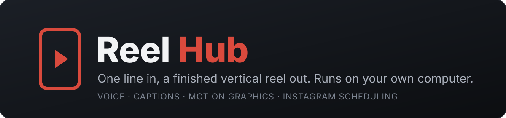
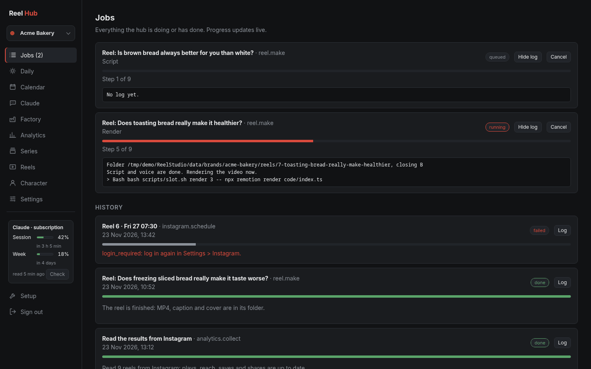
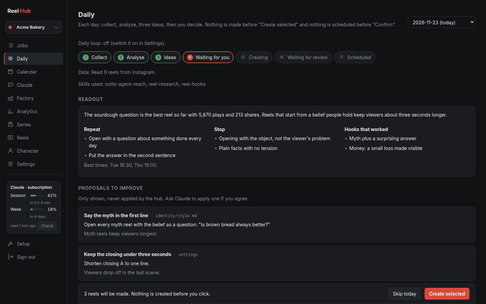
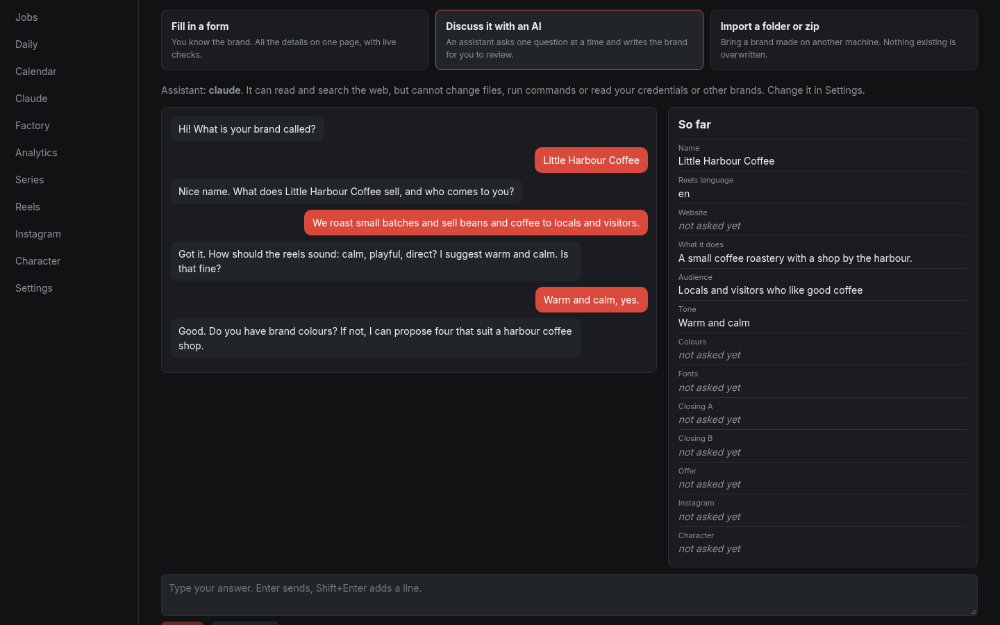
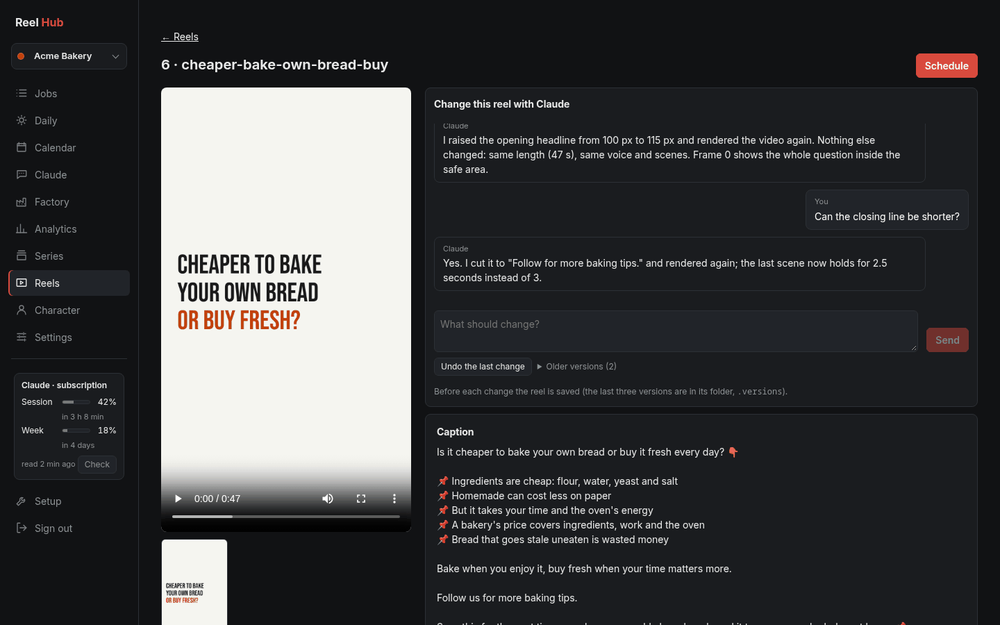
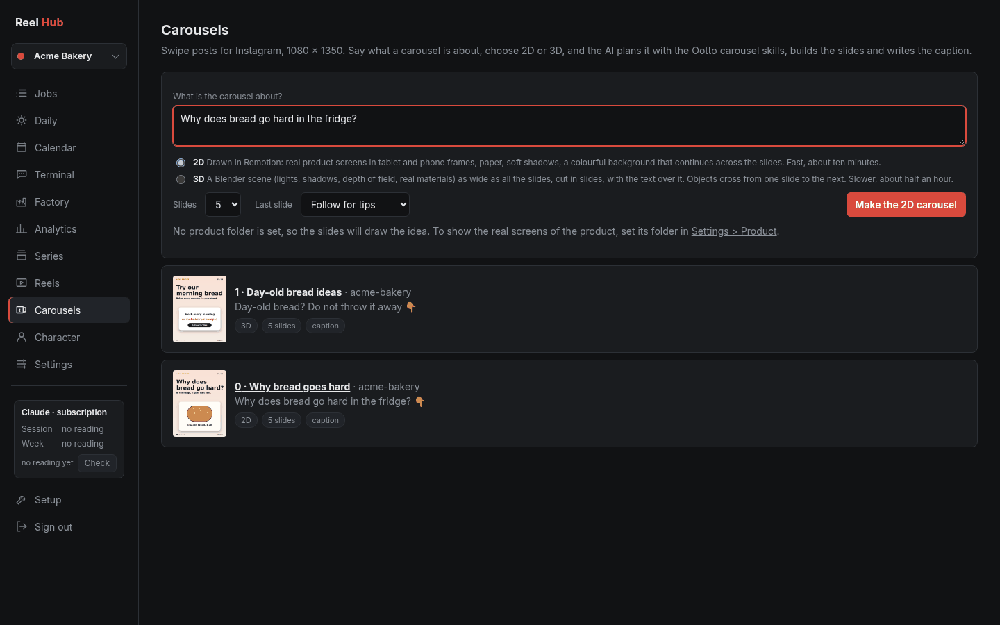
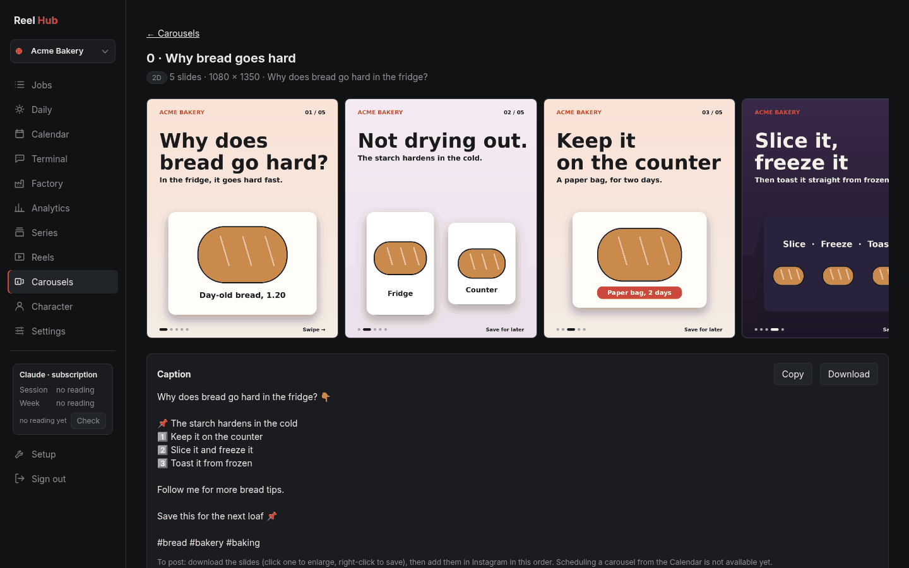
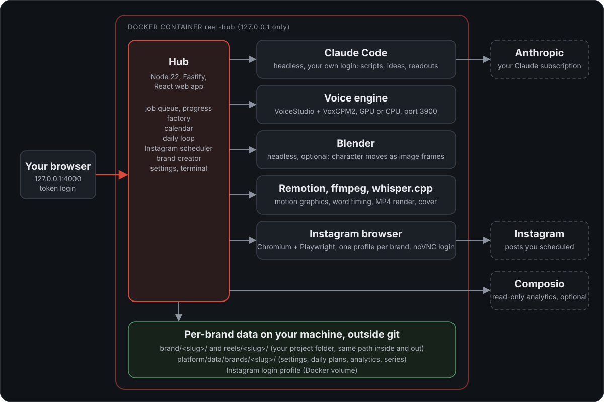
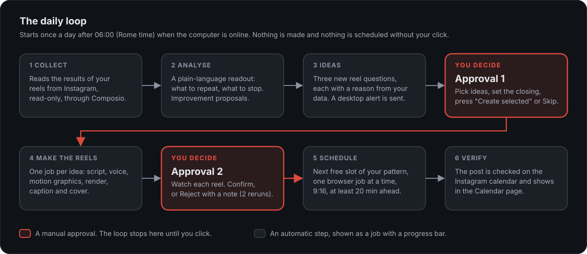
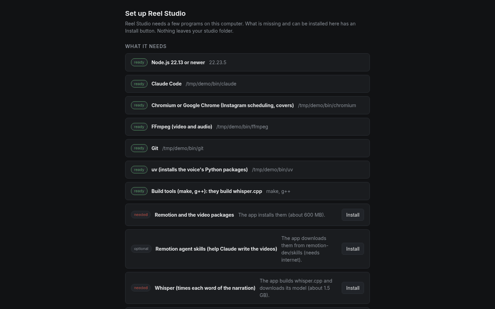

<p align="center">
  
</p>

<p align="center">
  <a href="LICENSE"></a>
  
  
  <a href="https://github.com/IacopoLibero/reel-studio/actions/workflows/ci.yml"></a>
  
</p>

# Reel Hub

**Reel Hub is a reel factory that runs on your own computer: you give it one line, it makes a finished vertical video (voice, word-timed captions, motion graphics, caption, cover) and schedules it on Instagram, with you approving the steps that matter.**

<p align="center">
  
</p>

All screenshots in this document show an invented demo brand, "Acme Bakery". No real account or data is shown.

## Contents

- [What it does](#what-it-does)
- [A tour of the hub](#a-tour-of-the-hub)
- [How it works](#how-it-works)
- [Quick start](#quick-start)
- [Requirements](#requirements)
- [Creating a brand](#creating-a-brand)
- [The daily loop and its approvals](#the-daily-loop-and-its-approvals)
- [Safety model](#safety-model)
- [Costs and limits](#costs-and-limits)
- [Configuration](#configuration)
- [Troubleshooting](#troubleshooting)
- [FAQ](#faq)
- [Project layout](#project-layout)
- [Contributing](#contributing)
- [License and credits](#license-and-credits)
- [Changelog](CHANGELOG.md)

## What it does

- Turns a question ("Why does real sourdough take two days?") into a 1080 x 1920 reel: script, cloned voice, word-timed captions,
  motion graphics written in code with Remotion, an optional Blender character, a caption with hashtags and a cover.
- Makes **carousels** (swipe posts, 1080 x 1350) in **2D** (Remotion) or **3D** (a Blender scene cut into slides), built on two Ootto skills, with the product's real screens when you give the brand a product folder.
- Runs a **factory**: pick several questions, make the reels in parallel, with a queue so the GPU does one voice job at a time.
- Schedules reels on Instagram through a real browser that you log in to yourself, and checks the result on Instagram's own calendar.
- Optionally runs a **daily loop**: it reads your results, writes a plain-language readout, proposes three ideas and waits for you.
- Handles **several brands**, each with its own pages, data, settings, daily loop and Instagram login.
- Runs as a **desktop app** (an Electron window with a tray icon) on Arch Linux: the hub is bound to `127.0.0.1` and your logins stay on your machine.

The repository holds the platform, a generic Remotion kit, the skills and a brand template. It holds **no brand**: your brands live
on your machine and stay out of git (see [Creating a brand](#creating-a-brand)).

## A tour of the hub

The hub is a web app on `http://127.0.0.1:4000`. The menu on the left is for the brand chosen in the switcher at the top.

### Jobs



Everything the hub does is a job with a progress bar and a log: scheduling, making a reel, reading analytics, creating a brand.

- Watch the step and the log of a running job. Cancel it if it is stuck.
- Jobs of different kinds wait in their own lanes: one browser job at a time, a few reels in parallel.
- A job that was running when the hub restarted is shown as failed with "interrupted"; run it again.

### Daily: the approval



The daily loop ends its automatic part here and waits for you. Nothing is made before you click.

- Read the readout and the proposals. Proposals are only shown, never applied by the hub.
- Untick ideas you do not want and change the closing (A: offer and website, B: follow for tips) of each.
- Press **Create selected** to start the reels, or **Skip today**.

### Daily: the review of a finished reel


- Play the video, read the caption and the automatic self-check.
- **Confirm** opens a slot dialog and schedules the reel on Instagram. **Reject** needs a note and reruns the reel (twice at most).
- Nothing is scheduled before you press Confirm.

### Calendar


- Shows what is scheduled on Instagram and the free slots of your pattern. Reels made here show their cover and closing.
- Click a free slot to schedule a reel there; drag a post to another slot to reschedule it.
- **Suggest best times** proposes times from your own results once there are enough reels with insights.

### Factory


- The list comes from the brand's `reel-questions.md` (hub data: `data/brands/<slug>/`). Tick questions and press **Send to factory**.
- The closing (A: offer and website, B: follow for tips) is chosen by keyword rules you can edit in Settings; override it per row.
- **Find new ideas** asks Claude for new questions, checked against your list for duplicates.

### Analytics


- **Refresh from Instagram** reads your results through Composio (read-only). **Write the readout** asks Claude what to repeat and what to stop.
- Cards show the best and worst reels; the chart shows plays (bars) and reach (line) per reel. The table also has **Followers gained** per video.
- **The whole page:** followers, reach, views, profile views and accounts engaged, one reading a day (kept in `analytics/pages/instagram.csv`). Threads and TikTok are not read yet.

### Series


- A series is a recurring format: a promise, a cadence, example hooks and the questions assigned to it.
- **Plan a series** asks Claude to propose one from your results; edit it before you keep it. For a run such as "30 days, one a day" it also writes the new episodes (up to 40); they go into the question list when you accept.
- Each question of a series is an **episode**. Tick several and **Send to the Factory** to make them together, then **Schedule finished, one a day** puts them on the first free slot of different days. A series' reels are listed here, with their state (Not made, Scheduled, Posted), and not among the single reels in **Reels**.

### Reels


- Every folder in the brand's `reels/` folder (`data/brands/<slug>/reels/` in your studio folder) with its cover, files (MP4, caption, cover) and state: not scheduled, in queue, scheduled.
- **Schedule** picks a free slot of your pattern and queues the Instagram job.
- **Click a reel** to open its own page (not a dialog): the video with a player, the cover, the caption, the script, the plan and the files. Next to the video is a **conversation with Claude**: say what to change ("make the headline bigger", "shorten the closing"), and Claude changes the reel's code, renders it again and answers; ask a question first if you only want to understand something. Each message continues the same Claude session, so follow-ups make sense. Before each change the reel is saved in its folder (`.versions`, the last three); **Undo the last change** (and *Older versions*) put a saved version back, saving the current one first so the undo can be undone; and if Claude fails the reel is put back as it was. One change runs at a time per reel; a reel that is being scheduled cannot be changed. A reel already on Instagram can be changed here, but Instagram keeps its own copy.

### New brand


- Three ways in: fill in a form, discuss it with an AI, or import a folder or zip. All three end in the same job.
- The form checks colours for contrast and font names against the Google fonts Remotion can load.



- The assistant asks one question at a time, in your language, and fills the summary beside the chat.
- At the end you review and edit the generated `brand.json` and style guide, then press Create.

### A reel's page



Click a reel in **Reels** to watch it and change it by talking to Claude; the last versions are kept and the undo button puts one back.

### Carousels



Swipe posts for Instagram, 1080 × 1350 (4:5). On the **Carousels** page you write what the carousel is about, choose **2D or 3D**, the number of slides (4 to 8) and the last slide (the brand's offer, or follow for tips), and press the button.

- **2D:** built in Remotion only: the product's real screens in drawn tablet and phone frames, paper and surface textures from real images, layered soft shadows, a fine grain, and a colourful background that continues across the slides.
- **3D:** one wide scene in Blender (Cycles on the GPU: lights, shadows, depth of field, real materials, a wooden table) rendered once and cut into slides, so objects cross from one slide to the next when you swipe; the text, the tags and the frame go over it in Remotion. The program ships a Blender kit with detailed props and checks (`scripts/carousel/blender/`).
- **Built on two Ootto skills,** both called every time: `ootto-viral-carousel` (which structure carousels in the niche save, never copying slides) and `ootto-carousel-builder` (the words of every slide: a scroll stopper, one idea per slide, a slide worth saving, one ask). A job fails if the AI did not call them.
- **The product:** set the brand's **product folder** in Settings > Product (a folder on this computer). It is read-only: the AI looks there for the real screens, images and words, and never changes anything in it. Without one, the slides draw the idea. Reels do not use it.
- **The result** is in `data/brands/<slug>/carousels/<n>-<name>/`: `slide-1.png` ... , `caption.md`, `plan.md`, `carousel.json` and the code. Click a carousel to see the slides side by side, copy the caption, download the slides, or make it again with a note. **Versions:** every change keeps the carousel as it was, and a **Version** switch on its page shows an older one and brings it back (**Use this version**). **Change one slide** (on the carousel's page): pick the slide, say what to change, and only that slide is drawn again; the others, the caption and the plan stay as they are, the slide's alt text is updated if its picture changed, and the old slides are kept in the carousel's `versions` folder. **To schedule** puts it in Instagram's own scheduler as an image post (slot picker as for a reel; the banner goes Scheduled, then Posted once the slot has passed). Every slide gets an **alt text** (`alt.json`, at most 100 characters, what the image shows in words people search for). A carousel is scheduled with a minimized window: Instagram's Edit step for images does not work without a real GPU. Per-carousel analytics are not built.



### Settings


- Posting schedule (the default is 3 posts on Sunday, Tuesday and Thursday, 2 on the other days), the daily loop and the factory rules.
- **Language of the reels** (per brand): the voice, the captions and the word timing follow it. Light voice mode is English only; use a voice sample in the same language.
- Blender device, Claude model, which content skills are on, the brand assistant, and deleting a brand (it goes to a trash folder).
- **Claude and Codex:** how each signs in, with its own login or with an API key (saved in a file only you can read; the page shows the last four characters), and a **Test** button. The **sidebar** shows the Claude usage: session and week bars with their reset times, or the cost with an API key.

The hub also has **Terminal** (a terminal in the page running Claude Code, or Codex if you chose it, with a **permission level** you pick: ask each time, edit files, plan only, or everything; every brand's data folder is within reach), the login to Instagram (in **Settings**: its state, and a button that opens a Chromium window to log in) and
**Character** (the moves of a brand's character).

## How it works



- **One app.** The Electron window starts the hub (Node 22, Fastify, React) as a separate process and shows it. The hub starts and watches
  VoiceStudio (the voice engine) and finds Blender; both are installed by the first-run setup into `data/tools/`, not packed in the app.
  Everything runs as you, with your own files.
  (`.claude/skills/reel/SKILL.md`) is the recipe for a whole reel.
- **Instagram goes through a browser, not an API.** Playwright drives a Chromium that you logged in to once. It follows a flow proven by
  hand, verifies the post on Instagram's calendar and never enters a password.
- **Per-brand data stays on your machine** and out of git.

The daily loop:



## Quick start

```bash
git clone https://github.com/IacopoLibero/reel-studio.git reel-studio && cd reel-studio
claude                       # once: log in to Claude Code, then quit
cd packaging/arch && makepkg -si     # builds the package from this repository and installs it with pacman
reel-studio                  # or open "Reel Studio" from your application menu
```

The shortest way, from the website: `curl -fsSL https://reel-studio.iacopolibero.dev/install.sh | bash` ([`install.sh`](install.sh) in this repository). It checks that this is Arch Linux, downloads the release package and `SHA256SUMS` from GitHub, refuses to go on if they differ, and installs with `sudo pacman -U` (options: `--version X.Y.Z`, `--from DIR` for a package you built, `--yes`, `--dry-run`; read it before you run it).

Or take the prebuilt package of the [latest release](https://github.com/IacopoLibero/reel-studio/releases/latest) (check it against `SHA256SUMS` there) and install it with `sudo pacman -U reel-studio-1.0.3-1-x86_64.pkg.tar.zst`. What changed in each version: [CHANGELOG.md](CHANGELOG.md).

The first start shows a **setup screen**. It checks what your computer has (Node, Claude Code, Chromium, FFmpeg, Git, uv, your graphics card) and
installs what the app can install itself:

1. **The video packages** (Remotion, about 600 MB): required.
2. **Blender** (the character, about 400 MB): optional; the app downloads it into `data/tools/`, or uses the one on your system.
3. **VoiceStudio** (the voice): pick a voice mode (best quality on an NVIDIA graphics card, best quality on the processor, light and English only, or no voice for now);
   then choose which voice models to download. Every model shows its licence first and downloads only after you tick that you read it, with a progress bar.
   Voices can be chosen, removed and added later from **Settings > Voice**.



Then open **New brand** in the menu: fill in the form, discuss it with the AI, or import a folder.

The window sits in the tray when you close it, so schedules and the daily loop keep running; **Quit** in the tray menu stops the hub. "Start at login" is in the tray menu too.
`reel-studio --hidden` starts it in the tray only. The package never touches your studio folder (`~/ReelStudio`): update it with a new `makepkg -si`, remove it with `sudo pacman -R reel-studio`.
`makepkg` builds from the last commit, so commit your changes first.

Day-to-day operation (start, update, logs, ports, environment) is in [platform/README.md](platform/README.md).

## Requirements

- **Arch Linux** (or a derivative) with `pacman`. The package depends on `nodejs`, `npm`, `git`, `ffmpeg`, `chromium`, `uv` and `electron`. The app is made for Arch Linux; other systems are not supported.
- **Claude Code** for the AI parts, with a Claude subscription (log in once with `claude`) **or** an Anthropic API key (Settings > Claude and Codex).
- **A GPU is recommended, not required.** An NVIDIA GPU with about 8 GB runs the voice engine (VoxCPM2) fast. Without it pick a processor mode in the setup:
  everything works, but making the voice of a 40 second reel can take many minutes instead of seconds. The hub, Blender (CPU rendering) and Remotion do not need a GPU.
- **Disk:** about 40 GB free for the best-quality voice on a GPU (VoiceStudio with its packages and models is about 33 GB), much less with the light or processor modes.
- **Internet** at first run: Blender, VoiceStudio and the voice models, and the Remotion agent skills are downloaded from their official sources.
- An Instagram **Business or Creator** account for scheduling. Optional: a Composio account (a free plan exists) for the Analytics page.

## Creating a brand

In the hub open the menu at the top and choose **New brand**. All three ways end in one job that validates everything, makes every
folder and file, and registers the brand without a restart.

1. **Fill in a form.** Name, slug, language, website, what it sells, audience, tone; four colours with a contrast check; two Google
   font names; a logo (a PNG up to 1 MB; without one, covers have no logo frame; change it later in Settings); the two closing lines A and B with a live preview of the last card, and the words that decide which closing a reel gets (words about what
   the brand offers give closing A, advice and daily work give B); an optional offer, Instagram account name, folder of source texts; and the
   voice (let the assistant suggest three voices and pick the one you like, reuse another brand's sample, upload a WAV with its text, or decide later).
2. **Discuss it with an AI.** A chat that asks one question at a time and shows a running summary. It proposes the closing lines and the closing words from what the brand sells. You review the generated
   `brand.json` and style guide before creating. The assistant is a global setting: `claude` (the default, read-only tools, no access to
   credentials or other brands), `codex`, or any command that reads the prompt on stdin. **Only `claude` has been tested.**
3. **Import** a folder or zip with a `brand.json` at the top, to move a brand between machines. Paths that climb out of the folder,
   links, oversized files and zip bombs are refused, and an existing slug is never overwritten.

A new brand has an empty question list, the daily loop off and no character, and every page shows a first-step message. Then:
log in to Instagram in Settings (the Instagram section opens a Chromium window; you type the password there), add the first questions (or press **Find new ideas** in the Factory), make the first reel.

**Optional character.** A brand may have a character (a mascot built in Blender). The Character page gives you a ready prompt for an AI
image tool (flat 2D vector, your colours, a sheet with views and eight expressions); you make the sheet elsewhere and upload it.
**Build previews** then asks Claude for a plan and a Blender script and shows flat previews you approve or send back with notes.
**This is experimental: it needs iteration and may not give a finished character**, and turning an approved preview into the moves
the reels use is still manual work. A brand with no character uses full-width scenes and works completely.

**Your brands are not in this repository.** They live in your studio folder (default `~/ReelStudio`): `data/brands/<name>/` is one brand: `identity/` (brand.json, style guide, logo), `mascot/` (the character, its voice and its rendered moves) and `reels/` (one folder per reel: audio, video, and the reel's own code in `code/`), `code/` (code the brand's reels share); its question list, the hub's data of the brand and its Instagram login are in the same folder, so a brand is one folder to back up, move or delete. `workspace/src/` has your branded Remotion code; the sounds every reel can use are in `sfx/` of the program. Back that folder up yourself (a private repository, a drive).

## The daily loop and its approvals

Off by default; switch it on per brand in Settings. Once a day, after 06:00 (Rome time, changeable) and when the computer is online,
the hub collects your results, analyses them, proposes **three ideas** and sends a desktop notification (if you installed the optional
host notifier, see [platform/docs/DAILY.md](platform/docs/DAILY.md)). Then it stops.

1. **Approval 1:** you pick ideas and the closing of each, and press **Create selected**. One `reel.make` job per idea.
2. **Approval 2:** for each finished reel you watch the video and press **Confirm** (it is scheduled on the next free slot, or the one
   you choose) or **Reject** with a note (it is made again, twice at most).

Nothing is created before the first click and nothing is scheduled before the second.

## Safety model

- The hub listens on `127.0.0.1` only and needs a token (random, in `data/dev-token`, mode 600). The app window signs in with a one-time pass that the hub gives only to a request carrying the token, so the token never appears in a command line or an address. The hub contains a terminal and a
  browser logged in to your Instagram: do not expose it to a network without your own authentication and TLS.
- **Credentials never leave the machine.** The Claude login (`~/.claude`), the Composio login (`~/.composio`) and the API keys you save in Settings (`data/claude-api-key`, `data/codex-api-key`, mode 600) stay on your computer, the Instagram session lives in the brand's own folder (`data/brands/<brand>/profile/`), and you type your Instagram password yourself in the browser window (in the Docker setup, the noVNC window).
- **What Claude jobs can read.** Jobs read untrusted web text, so `platform/hub/src/jobs/claude-safety.ts` denies them any read of `.env`,
  `~/.claude`, `~/.composio`, `~/.config` and the Instagram profile, and restricts research jobs to a few shell commands. The brand
  assistant has read-only tools and cannot see your other brands.
- **The one broad shell.** The reel-making and reel-editing jobs (`reel.make`, `reel.edit`: the chat on a reel's page) need a broad shell for voice, Blender and render. It cannot read those
  credential files or use `curl`, `wget`, `ssh` or `env`, but a prompt-injected model could still read other files in the project.
  Treat the project folder as the trust boundary.
- The jobs run as you, so they can reach what you can: that is why the brand assistant has read-only tools and the other jobs have the deny rules above.

Full policy and how to report a problem: [SECURITY.md](SECURITY.md).

## Costs and limits

- **Claude:** with the **login** (the default) jobs use your Claude subscription. A reel is one long headless session; a **carousel** is one too (a 3D one is longer: it renders a Blender scene and checks every object); a change in the reel chat is a shorter one; the daily loop adds a few more a day. Heavy use can hit your limits, so the sidebar shows how much of the **session** (five hours) and the **week** is used, with the time they reset. With an **API key** the jobs are paid per use on your Anthropic account instead and the sidebar shows what they cost (today and the last 7 days). Choose in **Settings > Claude and Codex**.
- **GPU for 3D carousels:** the 3D style renders with Cycles on your NVIDIA card (about a minute for the final render, a few minutes in all); without a GPU use the 2D style.
- **Composio:** the Analytics page calls Composio's Instagram tools; its free plan has a monthly quota. Check your Composio account.
- **Instagram scheduling:** Instagram accepts scheduled posts about **30 days ahead**, refuses a time **less than 20 minutes** away, and the video must be **9:16**.
  Scheduling uses the browser you log in to, not a paid API.
- Everything else is free software on your hardware. Using Instagram through an automated browser is subject to Instagram's terms.

## Configuration

The app needs no configuration file. Everything about a brand is in its folder (`brand.json`, `settings.json`), not in environment variables.
These optional variables change where the app looks (set them where your session sets its environment, for example `~/.config/environment.d/`):

| Variable | Default | What it does |
|---|---|---|
| `REEL_STUDIO_HOME` | `~/ReelStudio` | Your studio folder: `workspace/` (the Remotion project the program fills), `data/` (brands, hub state, `tools/`). Never touched by the package. |
| `HUB_PORT` | `4000` | Port of the hub, on `127.0.0.1` only. |
| `VOICE_PORT` | `3900` | Port of VoiceStudio, on `127.0.0.1` only. |
| `HUB_TOKEN` | random | A fixed token instead of the one in `data/dev-token`. |
| `CHROME_PATH` | system Chromium or Chrome | The browser used for Instagram. |

The other variables of the hub are in [platform/README.md](platform/README.md).

## Troubleshooting

- **The setup says something is missing.** Each line says what and how: `sudo pacman -S <package>` for the system programs, an Install button for what the app installs.
  A graphics card shown as "none found" with `nvidia-smi` saying "Driver/library version mismatch" is a driver that needs a reboot.
- **A model download looks stuck.** The bar shows the speed and the time left; "Cancel download" stops it and the next try continues where it stopped.
  The full log of each install step is in `data/setup/<step>.log`.
- **VoiceStudio blocks a model.** Its own licence review is not finished for most models, so the setup downloads with the same call its own settings use, after you read the licence.
  A licence such as CC-BY-NC does not allow commercial use: check it before you publish reels made with that voice.
- **Instagram "Reels" notice or the month picker blocks the scheduler.** Instagram shows a one-time notice about reels and a month picker
  for the date. The scheduler handles both (see the scheduler section of [platform/docs/DESIGN.md](platform/docs/DESIGN.md)). If a job fails,
  read its error in Jobs, dismiss the notice once in the browser window that opens when you press *Log in again* in Settings > Instagram,
  and run the job again. A `login_required` failure means: log in again there.
- **Instagram scheduling limits.** About 30 days ahead, at least 20 minutes of lead time, 9:16 only.
- **Out of GPU memory (8 GB).** Only one VoiceStudio can use the GPU: the app runs one, do not start another next to it. Voice jobs wait in a queue (`scripts/slot.sh voice 1 -- <command>`; renders use `render 3`). The jobs do this for you.
- **The first setup is slow.** VoiceStudio with its Python packages and models is about 33 GB for the best voice on a GPU. The Voice models list shows a progress bar for each download, and `data/setup/voicestudio.log` the rest. A failed download continues where it stopped when you press the button again.
- **Port already in use.** Another program uses 4000 or 3900: the app then uses what answers on 4000 instead of starting its own hub. Set `HUB_PORT` or `VOICE_PORT` to free ports.
- **A Remotion skill is missing.** The setup fetches them from upstream; if that was unreachable, press the step again when you are online (or run `scripts/install-remotion-skills.sh` in the workspace).

## FAQ

**Can I use it without a GPU?** Yes, in CPU mode. The voice is the slow part; the rest is the same.

**Does it post for me automatically?** It schedules in Instagram's own scheduler, after you confirm each reel. It never publishes at once.

**Do I need an Instagram API or a Facebook app?** No for scheduling (a browser you log in to). Analytics use Composio; Threads posting would need your own Meta app and is paused.

**Is my Instagram password stored?** No. You type it in the browser window of the hub; only the browser profile (cookies) stays in the brand's folder.

**Can I run two brands?** Yes, as many as you like. Each has its own Instagram login, settings and daily loop; browser jobs run one at a time.

**Can I use another AI than Claude?** Yes, Codex, as one choice for everything (Settings > AI tool): either Claude or Codex does all the AI work (reels, ideas, the daily loop, readouts, the character, the brand assistant). The hub runs `codex exec --json` (the prompt on stdin, `--sandbox workspace-write` for the jobs that make things, `read-only` for the others) as OpenAI documents for non-interactive use. It was written from that documentation and tested only with a stand-in Codex, never a real one, and the hub cannot limit single commands for Codex (it can for Claude): only its sandbox. Skills are linked into `.agents/skills`, where Codex looks for them, and a job that must use a skill fails if Codex did not open its SKILL.md, as it does with Claude. The Terminal page runs Codex too. **Codex is not tested**: the interface says so wherever it appears. Codex needs to be installed and signed in (`codex login`, or an API key in Settings).

**Where is my data?** In your studio folder, `~/ReelStudio` by default: `data/brands/<name>/` (one folder per brand: identity, character, reels, carousels, question list, Instagram login) and `workspace/` (the Remotion project the program fills; your reels' code is in the brand folders). The voice engine, Blender and their models are in `data/tools/` (the setup installs them again if you delete it). To back up, copy `~/ReelStudio` ([platform/README.md](platform/README.md)).

## Project layout

```text
packaging/arch/                     PKGBUILD, launcher and desktop entry of the pacman package
platform/desktop/                   the Electron app (window, tray, notifications, start at login)
platform/                           the hub (platform/hub), the desktop app (platform/desktop), docs, vendored Ootto skills
platform/docs/                      DESIGN (the hub), DAILY (skills, analytics, daily loop), BRANDS (multi-brand)
scripts/                            voice, whisper, slot queue, the public folder of a render, Ootto and Remotion skills, helpers
scripts/carousel/                   carousels: embed images, render and cut slides, the Blender 3D kit (props, textures, checks)
src/                                generic Remotion kit (src/kit) and cover (src/cover); your reels' code is in each brand's folder (`reels/<n>-<name>/code/`), outside this repository
brand/_template/                    the template new brands are made from (read from here, not copied into the workspace)
sfx/                                the sounds every reel can use (read from here)
.claude/skills/                     the reel skill and its helpers (reel, reel-hooks, reel-research, reel-insights, reel-threads) and the carousel skill
docs/images/                        screenshots and diagrams of this README
TODO.md                             open items and decisions
```

## Contributing

Open work is in [TODO.md](TODO.md). How to set up, test and send a change: [CONTRIBUTING.md](CONTRIBUTING.md).
The screenshots come from a scratch instance with an invented brand; see CONTRIBUTING.md before you replace one.

## License and credits

Reel Hub is MIT-licensed ([LICENSE](LICENSE)). It builds on other projects. The list below is a good-faith summary and **not legal
advice**; read each project's own license, especially for commercial use. Details: [THIRD_PARTY_NOTICES.md](THIRD_PARTY_NOTICES.md).

- **Ootto content skills** ([Ootto-AI/claude-content-skills](https://github.com/Ootto-AI/claude-content-skills)): MIT, vendored unmodified in `platform/skills/ootto/`.
- **Remotion** ([remotion.dev](https://www.remotion.dev)): not MIT. As stated by the maintainer of this project, it is free for teams of up to
  3 people, and larger companies need a company license. Read [remotion.dev/license](https://www.remotion.dev/license) yourself before you use it for a company.
- **Remotion agent skills** ([remotion-dev/skills](https://github.com/remotion-dev/skills)): downloaded from upstream at install time, not part of
  this repository and not redistributed. That repository declares no license, so check its terms yourself.
- **/brag** ([latent-spaces/brag](https://github.com/latent-spaces/brag), MIT, copyright 2026 Shunit Haviv Hakimi): its rules for a good launch video (the hook, a stranger understands it, show the real product, readable pace, one tone) are adapted in the `reel` skill, section "Make it land". The skill itself is not bundled.
- **VoiceStudio** ([debpalash/VoiceStudio](https://github.com/debpalash/VoiceStudio)): AGPL-3.0. Downloaded at first start and run as a separate local service, not bundled.
- **VoxCPM2** voice model ([openbmb/VoxCPM2](https://huggingface.co/openbmb/VoxCPM2)): the official model card states Apache-2.0 (checked 2026-11-20).
  Cloning a person's voice needs that person's consent.
- **Blender** ([blender.org](https://www.blender.org)): GPL-2.0-or-later, downloaded while building the image and used as a separate program.
- **whisper.cpp** ([ggml-org/whisper.cpp](https://github.com/ggml-org/whisper.cpp)): MIT. Playwright: Apache-2.0. Claude Code and Composio: their own terms.
